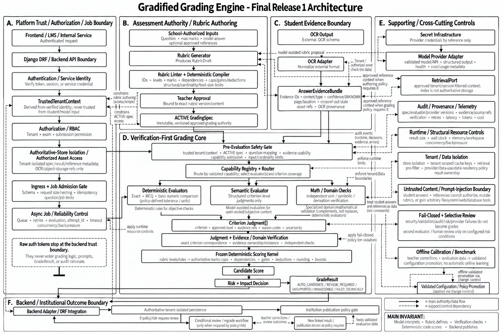

# Grading Core Architecture

## Read this first: current implementation versus target architecture

This repository contains a **verified grading-core foundation for the currently completed Release 1 scope**.

The architecture image below shows the **target Release 1 architecture**. It deliberately includes several integration/workflow components that are **not yet implemented in this repository**.



Do not read every box in that image as “finished”. Use the status sections below.

## Current verified implementation

The current implemented path is approximately:

```text
school-authorized question/rubric authority
        ↓
ACTIVE question authority projection
        ↓
normalized AnswerEvidenceBundle
        ↓
supported evaluator path
  ├─ CHOICE (deterministic)
  ├─ DIRECT text semantic boundary
  └─ bounded unitless NUMERIC N1–N4
        ↓
CriterionJudgment
        ↓
evidence / judgment verification
        ↓
frozen deterministic question scoring
        ↓
frozen deterministic paper aggregation
        ↓
candidate grading result for backend/workflow handling
```

Two additional integration foundations are implemented:

- **IF1 capability registry:** resolves an exact versioned evaluator capability record. It does **not** choose an evaluator for a question.
- **REF-1 reference context boundary:** validates and snapshots provenance-bearing reference context from a configured source. It does **not** implement real retrieval, tenant authentication, or reference approval.

## Target Release 1 components that are still integration/open work

The target diagram also contains components that remain open or only have a contract/seam today:

- real authentication / trusted tenant / RBAC integration;
- real backend ACTIVE-spec storage and authorized asset access;
- asynchronous job reliability, durable attempt IDs, persistence and idempotency;
- real OCR adapter against the OCR team's payload;
- exact question-classification → evaluator routing policy (IF2);
- real reference retrieval with tenant/version isolation;
- production semantic-provider adapter, benchmark and telemetry;
- complete units, symbolic math, derivation and composite evaluator breadth;
- complete risk/review/regrade/publication workflow;
- held-out validation and real-school-paper end-to-end evidence.

That distinction is intentional. Frozen grading-core rules should not be changed merely to make an external adapter easier to write.

## Authority chain

The conceptual target authority chain is:

`School-authorized inputs -> generated/validated rubric -> admitted OCR evidence -> explicitly selected validated capability -> criterion judgments -> verification -> deterministic reducer -> candidate score -> risk/review policy -> backend publication policy`

The model/evaluator interprets. **Deterministic code scores. The backend publishes.**

## Six responsibilities

1. **Assessment authority**  
   The school provides the question, maximum marks, model answer, and approved references. Generated rubrics must pass deterministic validation and the required teacher approval before becoming ACTIVE.

2. **Evidence**  
   OCR provides evidence about what the student submitted. OCR output carries provenance and uncertainty. It is evidence, not unquestioned truth.

3. **Interpretation**  
   A supported evaluator proposes criterion-level judgments within an explicitly admitted capability. The exact general routing policy is still open work.

4. **Verification**  
   Deterministic/domain checks verify relationships that can be checked independently: evidence references, numeric relations within the supported profile, reference binding, and other implemented checks.

5. **Scoring**  
   Only deterministic scoring code maps approved rubric levels/projections to marks and applies dependencies, gates, caps, deductions, rounding, and score bounds.

6. **Release safety**  
   Candidate results are not official grades. Backend/institution policy owns persistence, review, regrade and publication.

## Dependency boundaries

The grading core must not directly depend on:

- backend ORM/database tables;
- OCR vendor-specific JSON field names;
- frontend objects;
- provider SDK-specific response objects;
- arbitrary vector-database APIs;
- authentication tokens or raw secrets.

Use explicit adapters/ports at those boundaries.

## Architectural invariants

- A model/evaluator cannot create the authoritative numerical total.
- ACTIVE rubric/spec versions are immutable for a grading run.
- Missing OCR confidence remains explicit uncertainty.
- Parser/provider/technical failure is not automatically a student error.
- Evidence references must resolve to the correct submission/question.
- Tenant authority comes only from trusted backend/workflow context.
- Real retrieval must be tenant/version scoped.
- Unsupported capability must not be forced through a generic grader.
- Safety-critical technical/validation failure blocks unsafe automatic progression.
- Candidate result is separate from the official published grade.
- Teacher corrections/regrades create versioned/new linked state; they do not silently mutate historical results.
- Quality/benchmark evidence must precede production capability promotion.

## Deployment style

Release 1 should remain a logically modular grading application. Do not split components into microservices unless actual scale, ownership, or reliability evidence later justifies it.
