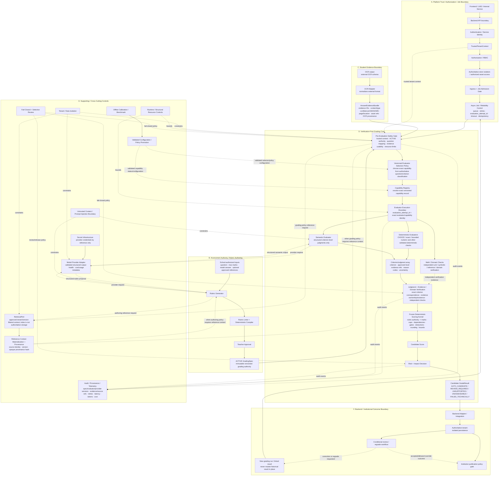

# Gradified Grading Engine Architecture

This document is the canonical **Release 1 target architecture** for the grading engine and also records the narrower path that is already implemented in this repository.

The diagram below is kept as Mermaid source inside Markdown so every arrow is reviewable in Git history.



## Why this diagram is canonical

 In particular:

1. **Reference context is not student evidence.** `RetrievalPort` / reference context must never feed `AnswerEvidenceBundle`. Student/OCR evidence and reference context remain separate inputs.
2. **Selection, registry resolution, and evaluator execution are distinct.** The target architecture now shows `Selection Policy -> Capability Registry -> Evaluator Execution Boundary` explicitly. The current repository implements the registry, not the generic selector.
3. **Independent math/domain checks verify rather than silently author semantic judgments.** Their results feed the verification stage. A deterministic evaluator may itself use domain logic when that behavior is the selected capability, but independent checks do not bypass criterion-judgment verification.
4. **Model/provider output never bypasses verification or deterministic scoring.** The provider may propose rubric structure or semantic judgments only through bounded interfaces.
5. **A regrade creates a new grading run/result.** Historical results are never silently mutated in place.
6. **Backend publication authority stays outside the grading core.** A candidate result is not an official published grade.

## Current implemented core

The repository currently implements and verifies this narrower path:

```text
school-authorized / ACTIVE grading authority
        +
AnswerEvidenceBundle
        ↓
implemented evaluator path:
    CHOICE
    DIRECT semantic text
    bounded unitless NUMERIC N1-N4
        ↓
CriterionJudgment
        ↓
evidence / judgment verification
        ↓
frozen deterministic question scoring
        ↓
frozen deterministic paper aggregation
        ↓
candidate grading result for backend/workflow handling
```

Additional implemented integration foundations:

- **IF1 capability registry:** exact versioned capability-record resolution; it does not choose the evaluator.
- **REF-1 reference-context boundary:** bounded, provenance-preserving materialization from a configured source; it does not implement real tenant authentication or retrieval infrastructure.

## Target components still open or requiring real integration evidence

- generic versioned evaluator selection/routing policy;
- evaluator-attempt -> judgment provenance binding;
- real OCR adapter against the OCR team's actual payload;
- trusted backend/auth/tenant integration;
- real reference retrieval with tenant/version isolation;
- production semantic-provider adapter, telemetry and benchmark evidence;
- units, broader symbolic math, derivation and composite evaluator breadth;
- durable idempotency/persistence semantics;
- complete risk/review/regrade/publication workflow;
- real subjective and numeric/math school-paper end-to-end runs;
- held-out academic validation and production reliability evidence.

## Main invariants

- The school owns assessment content and final approved grading authority.
- OCR is evidence, not unquestioned truth.
- Models interpret; they do not own the authoritative numerical score.
- Deterministic scoring code alone maps approved rubric authority to marks.
- Technical/parser/provider failures are not student mistakes.
- Tenant authority comes only from trusted backend/workflow context.
- Reference context is provenance-bearing support context, not student evidence.
- Candidate results are not official published grades.
- Regrade/correction creates new linked/versioned state rather than silently rewriting history.
- Capability promotion requires benchmark/validation evidence rather than runtime self-assertion.

## Integration rule

External systems should adapt **to these boundaries**. Do not change frozen scoring semantics merely because an OCR, backend, provider, or retrieval implementation exposes a different payload shape.
